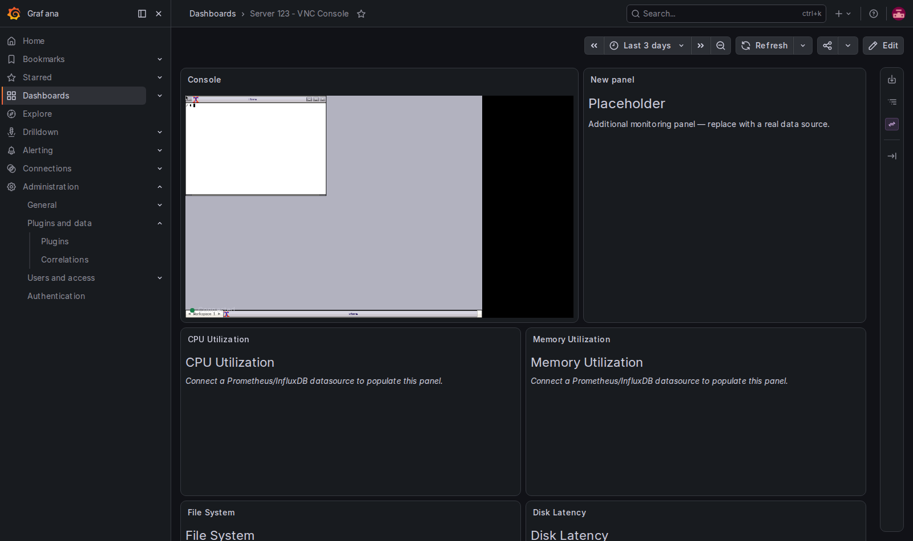
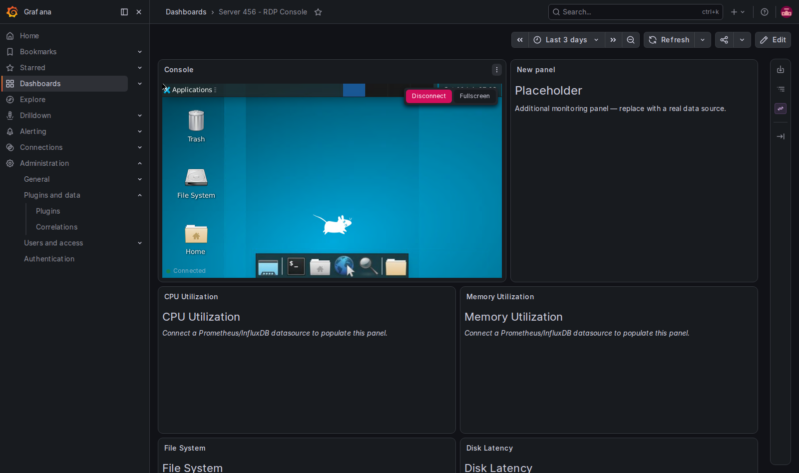
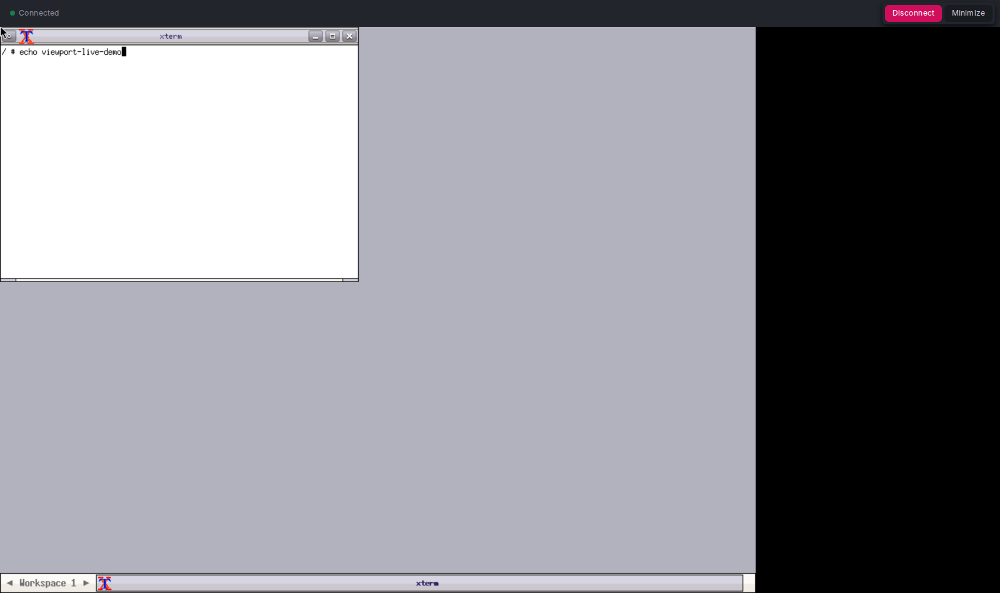

# Viewport - RDP, SSH, and VNC Viewer for Grafana

Provides a embedded view various remote connection protocols leveraging Apache Guacamole to broker connections.  


## Screenshots

<p>
  
  
  
</p>


## Quick Start (Provides Grafana, Viewport, and Gucamole via Docker.)

```bash
git clone https://github.com/SparkAnswers/viewport
cd viewport
docker compose up

# Grafana:   http://localhost/grafana/   (admin / admin)
# Guacamole: http://localhost/guacamole/ (guacadmin / guacadmin)
```


## Configuration

1. **App settings** (Administration → Plugins → Viewport → Configuration):
   - Guacamole server URL (server-side) and client tunnel URL (browser-side)
   - JSON secret key — must match the `JSON_SECRET_KEY` env of the Guacamole container (generate with `openssl rand -hex 16`)
   - Named connections (protocol, host, port, credentials)
2. **Panel options** (per dashboard panel):

| Option | Description |
|--------|-------------|
| Mode | `Connection` (named connection) or `Host` (dynamic host + credential profile) |
| Connection | Name of a centrally-managed connection (supports dashboard variables) — Connection mode |
| Host / Port / Profile | Hostname (supports variables, e.g. `${server}`), optional port, and the credential profile that supplies protocol + credentials — Host mode |
| Auto Connect | Connect when the panel loads |
| Read Only | View-only mode (no input) |

**Three ways to handle credentials:**

1. **Stored** (default) — the connection's password lives in Grafana's encrypted storage, decrypted only by the backend.
2. **Credential profile** — one shared credential reused across a fleet of hosts. Combine with Host mode and a dashboard variable to build drill-down dashboards: pick a machine from a dropdown and the session just works. Profiles can restrict usable hosts via an `allowedHosts` glob list.
3. **Prompt** — nothing stored anywhere: the user is asked for credentials at connect time; they broker one session server-side and are kept only in the panel's memory.

Demo dashboards for all three ship with the stack (`Fleet Drill-Down`, `Prompt Credentials`, and the original VNC/RDP consoles).

## Usage

1. Define connections on the Viewport app configuration page
2. Add a "Viewport" panel to your dashboard and pick a connection
3. Click "Connect" or enable auto-connect
4. Double-click the panel to expand to fullscreen; Escape to return

___


## Development 

**Developing the plugin?** Build it locally instead of pulling the release: in
`docker-compose.yml`, drop the `GF_INSTALL_PLUGINS` line and uncomment the
`./viewport-app/dist` mount, then `cd viewport-app && npm install && npm run build`.

## Architecture

```
Browser (panel)  ──▶  Grafana  ──resource API──▶  Viewport backend (Go)
                                                     │ mints scoped session token
                                                     ▼
Browser (panel)  ──WebSocket tunnel──▶  Guacamole ── json-auth
                                            │
                                          guacd ──VNC/RDP/SSH──▶ target machines
```

See [viewport-app/ARCHITECTURE.md](viewport-app/ARCHITECTURE.md) for the full design, including the credential flow and the backend resource API.

## Plugin Development

```bash
cd viewport-app

npm install
npm run build            # frontend + backend
npm run build:frontend   # webpack only
npm run build:backend    # Go backend only (requires Go 1.24+)
npm test                 # jest + go test
npm run dev              # webpack watch mode
```
